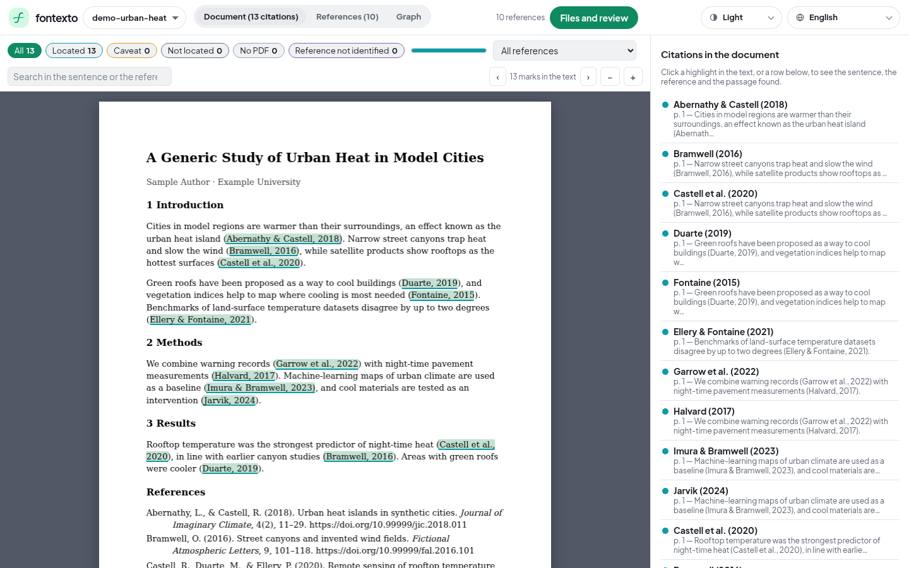
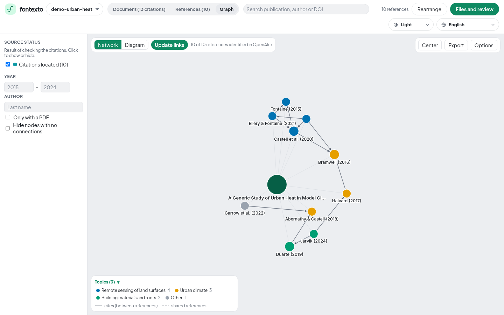
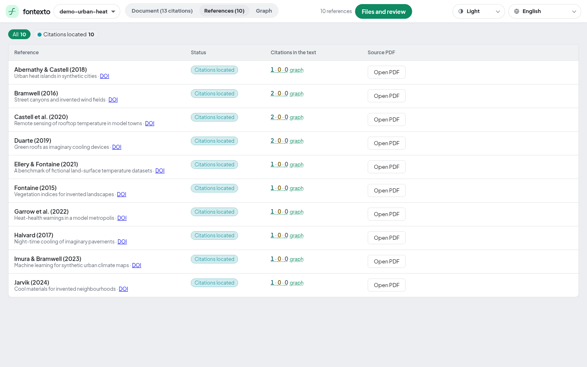

# Fontexto

[English](README.md) · **Español** · [Русский](README.ru.md) · [Português (Brasil)](README.pt-BR.md)

Fontexto relaciona cada cita de un documento académico (tesis, disertación, artículo) con el pasaje exacto de la fuente citada. Sube tu PDF: Fontexto lee la lista de referencias, busca versiones gratuitas y legales de los artículos citados y, para cada cita, muestra la página donde la fuente lo dice, lista para que la revises. Pruébalo en **[fontexto.com](https://fontexto.com)**.



## Qué hace

- **Citas → pasajes.** Cada cita del texto (autor–año o numérica) se relaciona con su referencia y con pasajes candidatos del PDF de la referencia, etiquetados como *Localizado*, *Salvedad* o *No localizado*. Las etiquetas son candidatas para revisión humana, nunca una prueba.
- **Extracción de referencias sin `.bib`.** Listas ABNT, APA, Harvard, IEEE, Vancouver, GOST, DIN, autor–año francés y GB/T 7714, incluidas referencias en cirílico y en chino, tesis, DOI raros y listas sin el título "Referencias".
- **PDF gratuitos, de forma legal.** Las copias en acceso abierto se buscan en OpenAlex, Crossref, Unpaywall, Europe PMC, arXiv, Semantic Scholar y CORE. Del navegador solo salen el DOI, el título, el año y el primer autor de la referencia.
- **Red de referencias (grafo v2).** Con un clic en *Buscar vínculos entre referencias*, OpenAlex indica cuáles de tus referencias se citan entre sí (flechas) y cuáles comparten referencias (líneas discontinuas). Los nodos se colorean por tema, y la leyenda, en la que se puede hacer clic, alterna entre tema, subcampo y campo en bibliografías amplias. Zoom, desplazamiento y pellizco, vecinos al pasar el ratón, tamaño de los nodos por citas en el texto o globales, línea de tiempo por año, filtros por año, tipo y tema, y exportación a PNG o SVG de 1600×900. Sin la búsqueda, las referencias se agrupan por palabras clave del título.
- **Cuatro idiomas.** La interfaz está en inglés (predeterminado), español, ruso y portugués de Brasil.
- **Privado por diseño.** En la edición web, tus PDF nunca salen del navegador (IndexedDB). No hay analítica ni scripts de terceros.





*Las capturas usan un documento de ejemplo y referencias ficticias. La interfaz se muestra en inglés.*

## Requisitos

- Node.js ≥ 20.10 (probado con Node 24)

## Ejecutar en local

```bash
npm install
npm run demo:seed        # opcional: crea un proyecto de demostración totalmente sintético en ./data
npm run dev              # API en 127.0.0.1:5174 + interfaz en http://127.0.0.1:5173
```

Compilación de producción:

```bash
npm run build            # comprobación de tipos + bundle web + servidor
npm start                # sirve la API y la interfaz en http://127.0.0.1:5174
```

Ingesta de archivos locales sin subirlos ni copiarlos:

```bash
npm run ingest -- --project mi-tesis --name "Mi tesis" \
  --bib ruta/refs.bib --main ruta/tesis.pdf --refs "ruta/carpeta-de-articulos"
```

Los archivos se registran **por ruta**: nunca se copian ni se modifican. Las variables de entorno (puerto, carpeta de datos, claves opcionales `OPENALEX_API_KEY`, `CORE_API_KEY` y `S2_API_KEY` del proxy de acceso abierto) están descritas en el [README en inglés](README.md#environment).

## Pruebas

```bash
npm test
```

Todos los datos de prueba son sintéticos: obras inventadas con DOI del prefijo ficticio `10.99999` y PDF generados durante la ejecución.

## Reglas de integridad científica

- No se inventa ningún dato bibliográfico, página ni coordenada. Lo desconocido se muestra como no disponible.
- Las coincidencias débiles quedan *sin verificar* hasta que una persona las confirma.
- Las relaciones temáticas son solo *sugeridas* y nunca implican una cita.
- Los métodos automáticos nunca marcan una evidencia como *validada*.

Cómo se calculan las etiquetas y sus límites: [`docs/matcher-evaluation.md`](docs/matcher-evaluation.md) (en inglés).

## Edición web y ejecutable de Windows

`npm run build:site` genera un sitio estático (`dist/site`) sin servidor de aplicación: el análisis de los PDF, la extracción de referencias y la búsqueda de pasajes se ejecutan en Web Workers, y los proyectos quedan en el IndexedDB del navegador. El único código de servidor es el pequeño proxy de acceso abierto de `functions/api/oa/`. `npm run package:win` genera la edición sin conexión para Windows. Detalles en el [README en inglés](README.md).

## Seguridad

Informa de vulnerabilidades en privado, como se explica en [SECURITY.md](SECURITY.md).

## Licencia

Fontexto es software libre bajo la [GNU Affero General Public License v3.0 o posterior](LICENSE) (AGPL-3.0-or-later). Si ejecutas una versión modificada como servicio en red, debes ofrecer su código fuente a sus usuarios.
