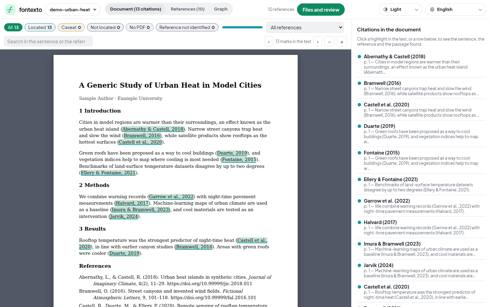
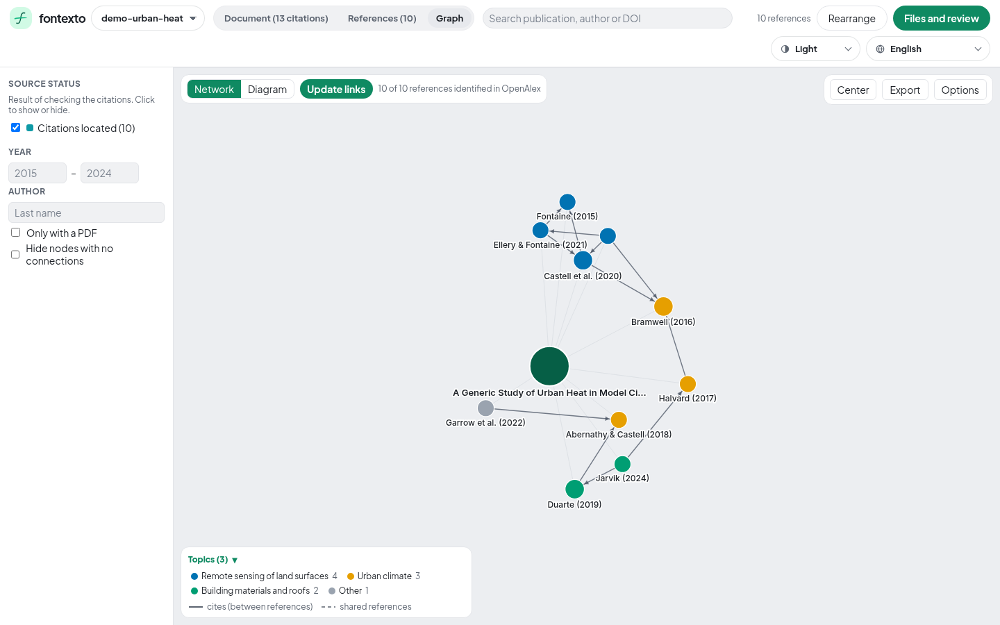
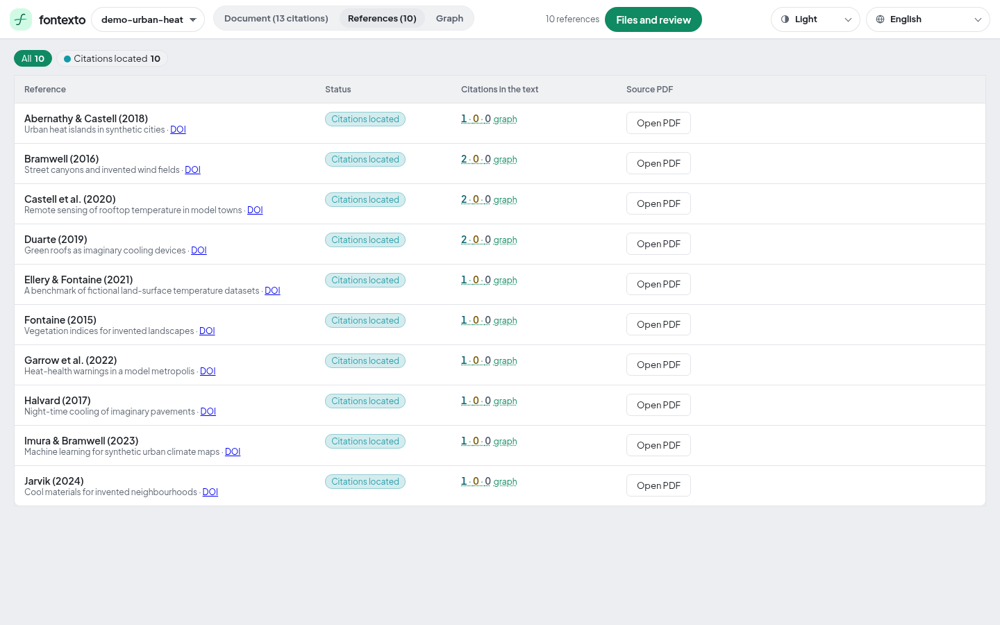

# Fontexto

**English** · [Español](README.es.md) · [Русский](README.ru.md) · [Português (Brasil)](README.pt-BR.md)

Fontexto links every citation in an academic document (thesis, dissertation, article) to the exact passage in the source it cites. Upload your PDF: Fontexto reads the reference list, looks up legal free versions of the cited papers, and for each citation shows the page where the source says it, ready for you to check. Try it at **[fontexto.com](https://fontexto.com)**.



## What it does

- **Citations → passages.** Each in-text citation (author–year or numbered) is matched to its reference and to candidate passages in the reference PDF, labelled *Located*, *Caveat* or *Not located*. Labels are candidates for human review, never proof.
- **Reference extraction without a `.bib`.** ABNT, APA, Harvard, IEEE, Vancouver, GOST, DIN, French author–year and GB/T 7714 lists, including references in Cyrillic and Chinese, theses, odd DOIs, and lists without a "References" heading.
- **Free PDFs, legally.** Open-access copies are looked up in OpenAlex, Crossref, Unpaywall, Europe PMC, arXiv, Semantic Scholar and CORE. Only the reference's DOI, title, year and first author leave the browser.
- **Reference network (graph v2).** One click on *Find links between references* asks OpenAlex which of your references cite each other (arrows) and which share references (dashed lines). Nodes are coloured by topic, and the clickable legend switches between topic, subfield and field for broad bibliographies. Zoom, pan and pinch, hover to see neighbours, size nodes by in-text or global citations, switch to a timeline by year, filter by year, type and topic, and export a 1600×900 PNG or SVG. Without the lookup, references are grouped by title keywords.
- **Four languages.** The interface is in English (default), Spanish, Russian and Brazilian Portuguese.
- **Private by design.** In the web edition your PDFs never leave the browser (IndexedDB). There are no analytics or third-party scripts.





*Screenshots use a fictional example document and fictional references.*

## Requirements

- Node.js ≥ 20.10 (tested with Node 24)

## Running locally

```bash
npm install
npm run demo:seed        # optional: creates a fully synthetic demo project in ./data
npm run dev              # API on 127.0.0.1:5174 + UI on http://127.0.0.1:5173
```

Production build:

```bash
npm run build            # typecheck + web bundle + server
npm start                # serves API and UI on http://127.0.0.1:5174
```

### Ingesting local files without uploading or copying them

```bash
npm run ingest -- --project my-thesis --name "My thesis" \
  --bib path/to/refs.bib --main path/to/thesis.pdf --refs "path/to/articles-folder" \
  [--exclude some-substring ...] [--shareable]
```

- Files are registered **by path**. They are never copied or modified, and removing them from a project never deletes the originals.
- Extracted text is cached in `data/projects/<id>/derived/`.

### Environment

| Variable | Default | Meaning |
| --- | --- | --- |
| `CITATION_GRAPH_PORT` | `5174` | API port |
| `CITATION_GRAPH_HOST` | `127.0.0.1` | bind address |
| `CITATION_GRAPH_DATA_DIR` | `./data` | project storage (git-ignored) |
| `CITATION_GRAPH_EXTERNAL_METADATA` | off | `on` allows opt-in OpenAlex lookups. Only DOIs are sent, and each request needs explicit consent. |
| `OPENALEX_API_KEY`, `CORE_API_KEY`, `S2_API_KEY` | unset | optional catalogue keys for the open-access proxy (server side only; on Cloudflare Pages set them as secrets). Without them OpenAlex runs on the free budget, CORE is skipped and Semantic Scholar is rate-limited. |

## Tests

```bash
npm test
```

- All fixtures are synthetic: invented works with DOIs under the fictitious prefix `10.99999`, and PDFs generated during the test run.
- An optional smoke test runs against your own local data when `SMOKE_BIB`, `SMOKE_MAIN` and `SMOKE_REFS` are set. It is skipped otherwise.

## Scientific-integrity rules

- No bibliographic data, page or coordinate is invented. Unknown values are shown as unavailable.
- `confirmed` means the reference was located in the documents (DOI or title match in a bibliography, or the main document's declared `.bib`).
- Weak matches are `unverified` until a researcher confirms them.
- Thematic relations are only `suggested` and never imply a citation; links from OpenAlex are labelled as such.
- Colours and categories are presentation only.
- Automatic methods can never mark evidence as `validated`.

## How the labels are computed

The citing sentence (markers removed) is segmented from the main PDF; every sentence of the reference PDF (bibliography excluded) is scored by IDF-weighted overlap of content terms (numbers, acronyms, stems, a PT↔EN glossary), with an optional multilingual semantic re-ranking. The best passages get one of:

- **Located**: a passage shares most of the sentence's rare terms;
- **Caveat**: weaker overlap, a number from the sentence missing in the passage, or only the abstract matches;
- **Not located**: no similar passage, no reference PDF, no extractable text, or a sentence with too little content.

See [`src/core/evidence.ts`](src/core/evidence.ts), the design notes in [`docs/architecture-citation-graph.md`](docs/architecture-citation-graph.md) and how the matcher is measured in [`docs/matcher-evaluation.md`](docs/matcher-evaluation.md).

## Web edition (fontexto.com)

`npm run build:site` builds a static site (`dist/site`) with **no application server**: PDF parsing (pdf.js), reference extraction, linking and matching run in Web Workers (`src/web/local/`, on top of the platform-neutral `src/core/coreStore.ts`), and projects live in the browser's IndexedDB. The only server code is the small open-access proxy in `functions/api/oa/` (Cloudflare Pages Functions).

- Optional semantic search (a multilingual sentence-embedding model, ~135 MB, downloaded once and cached) needs the model files: `npm run fetch-model` (SHA-256 pinned) before `npm run build:site`.
- Cloudflare Pages: `npx wrangler pages deploy dist/site --project-name fontexto --branch <branch>`. The `_headers` file (strict CSP + Trusted Types, COOP/COEP/CORP, HSTS) is generated from `src/server/securityHeaders.ts`.
- End-to-end check in headless Chrome: `scripts/e2e/web-flow.mjs` (see its header for the variables).

## Windows executable (offline edition)

```bash
npm run package:win
```

This writes a portable folder to `dist/win/Fontexto/` with `Fontexto.exe` (starts the local server and opens the UI in your browser) and `resources/` (keep it next to the exe). No Node.js install is needed at runtime. The server binds to `127.0.0.1` on port `5174` or the next free port. Project data lives in `%APPDATA%\CitationTrace` (the product's former name, kept so existing projects stay in place). Run `Fontexto.exe --no-browser` or set `CITATION_GRAPH_NO_BROWSER=1` to start without a browser. The executable is unsigned, so Windows SmartScreen may warn on first launch.

## Security

Please report vulnerabilities privately as described in [SECURITY.md](SECURITY.md).

## License

Fontexto is free software under the [GNU Affero General Public License v3.0 or later](LICENSE) (AGPL-3.0-or-later). If you run a modified version as a network service, you must offer its source code to its users.
