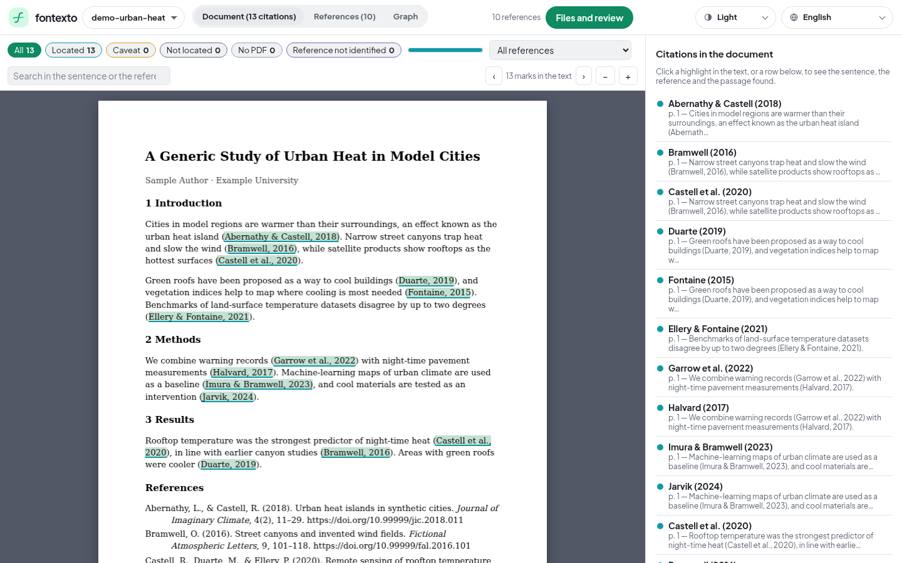
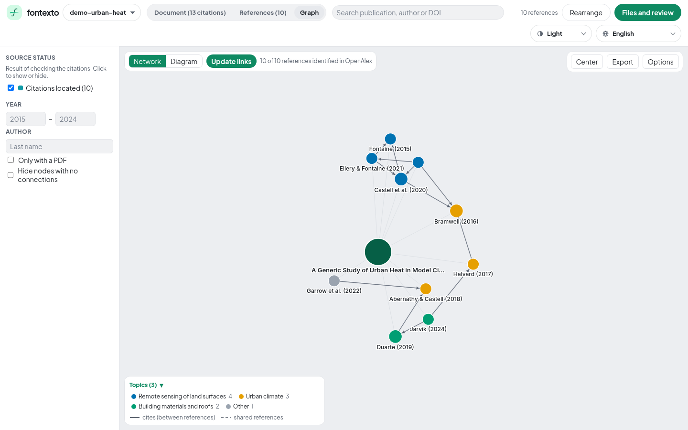
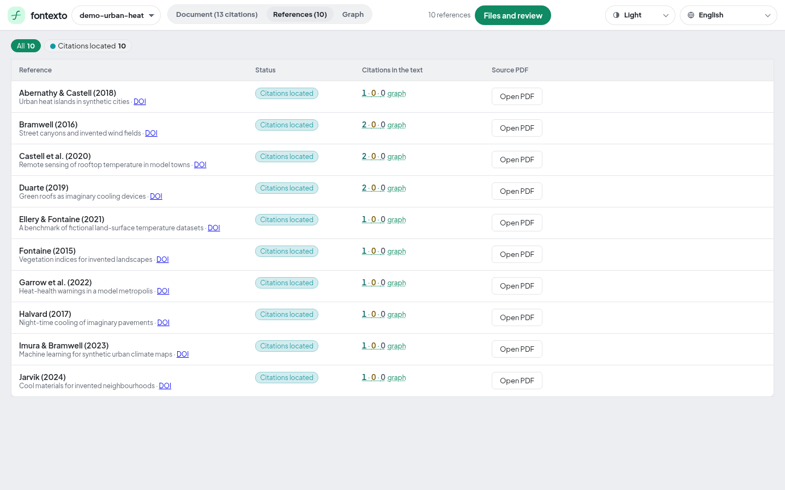

# Fontexto

[English](README.md) · [Español](README.es.md) · [Русский](README.ru.md) · **Português (Brasil)**

O Fontexto liga cada citação de um documento acadêmico (TCC, dissertação, tese, artigo) ao trecho exato da fonte citada. Envie seu PDF: o Fontexto lê a lista de referências, busca versões gratuitas e legais dos artigos citados e, para cada citação, mostra a página em que a fonte diz aquilo, pronta para você conferir. Experimente em **[fontexto.com](https://fontexto.com)**.



## O que ele faz

- **Citações → trechos.** Cada citação do texto (autor–data ou numérica) é ligada à sua referência e a trechos candidatos do PDF da referência, com o rótulo *Localizado*, *Ressalva* ou *Não localizado*. Os rótulos são candidatos para revisão humana, nunca uma prova.
- **Extração de referências sem `.bib`.** Listas ABNT, APA, Harvard, IEEE, Vancouver, GOST, DIN, autor–data francês e GB/T 7714, inclusive referências em cirílico e em chinês, teses, DOIs estranhos e listas sem o título "Referências".
- **PDFs gratuitos, de forma legal.** As cópias em acesso aberto são buscadas na OpenAlex, Crossref, Unpaywall, Europe PMC, arXiv, Semantic Scholar e CORE. Do navegador só saem o DOI, o título, o ano e o primeiro autor da referência.
- **Rede de referências (grafo v2).** Com um clique em *Buscar ligações entre referências*, a OpenAlex informa quais das suas referências citam umas às outras (setas) e quais compartilham referências (linhas tracejadas). Os nós são coloridos por tema, e a legenda clicável alterna entre tema, subárea e área em bibliografias amplas. Zoom, arrastar e pinça, vizinhos ao passar o mouse, tamanho dos nós por citações no texto ou globais, linha do tempo por ano, filtros por ano, tipo e tema, e exportação em PNG ou SVG de 1600×900. Sem a busca, as referências são agrupadas por palavras-chave do título.
- **Quatro idiomas.** A interface está em inglês (padrão), espanhol, russo e português do Brasil.
- **Privado por padrão.** Na versão web, seus PDFs nunca saem do navegador (IndexedDB). Não há análise de uso nem scripts de terceiros.





*As capturas usam um documento de exemplo e referências fictícias. A interface aparece em inglês.*

## Requisitos

- Node.js ≥ 20.10 (testado com Node 24)

## Rodar localmente

```bash
npm install
npm run demo:seed        # opcional: cria um projeto de demonstração totalmente sintético em ./data
npm run dev              # API em 127.0.0.1:5174 + interface em http://127.0.0.1:5173
```

Build de produção:

```bash
npm run build            # checagem de tipos + bundle web + servidor
npm start                # serve a API e a interface em http://127.0.0.1:5174
```

Ingestão de arquivos locais sem enviar nem copiar:

```bash
npm run ingest -- --project meu-tcc --name "Meu TCC" \
  --bib caminho/refs.bib --main caminho/tcc.pdf --refs "caminho/pasta-de-artigos"
```

Os arquivos são registrados **pelo caminho**: nunca são copiados nem alterados. As variáveis de ambiente (porta, pasta de dados, chaves opcionais `OPENALEX_API_KEY`, `CORE_API_KEY` e `S2_API_KEY` do proxy de acesso aberto) estão no [README em inglês](README.md#environment).

## Testes

```bash
npm test
```

Todos os dados de teste são sintéticos: obras inventadas com DOIs do prefixo fictício `10.99999` e PDFs gerados durante a execução.

## Regras de integridade científica

- Nenhum dado bibliográfico, página ou coordenada é inventado. O que é desconhecido aparece como indisponível.
- Correspondências fracas ficam *não verificadas* até uma pessoa confirmar.
- Relações temáticas são só *sugeridas* e nunca implicam citação.
- Métodos automáticos nunca marcam uma evidência como *validada*.

Como os rótulos são calculados e seus limites: [`docs/matcher-evaluation.md`](docs/matcher-evaluation.md) (em inglês).

## Versão web e executável para Windows

`npm run build:site` gera um site estático (`dist/site`) sem servidor de aplicação: a leitura dos PDFs, a extração de referências e a busca de trechos rodam em Web Workers, e os projetos ficam no IndexedDB do navegador. O único código de servidor é o pequeno proxy de acesso aberto em `functions/api/oa/`. `npm run package:win` gera a versão offline para Windows. Detalhes no [README em inglês](README.md).

## Segurança

Relate vulnerabilidades em particular, como explicado em [SECURITY.md](SECURITY.md).

## Licença

O Fontexto é software livre sob a [GNU Affero General Public License v3.0 ou posterior](LICENSE) (AGPL-3.0-or-later). Se você rodar uma versão modificada como serviço em rede, precisa oferecer o código-fonte dela aos usuários.
