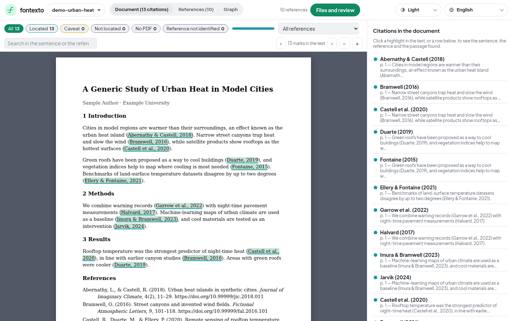
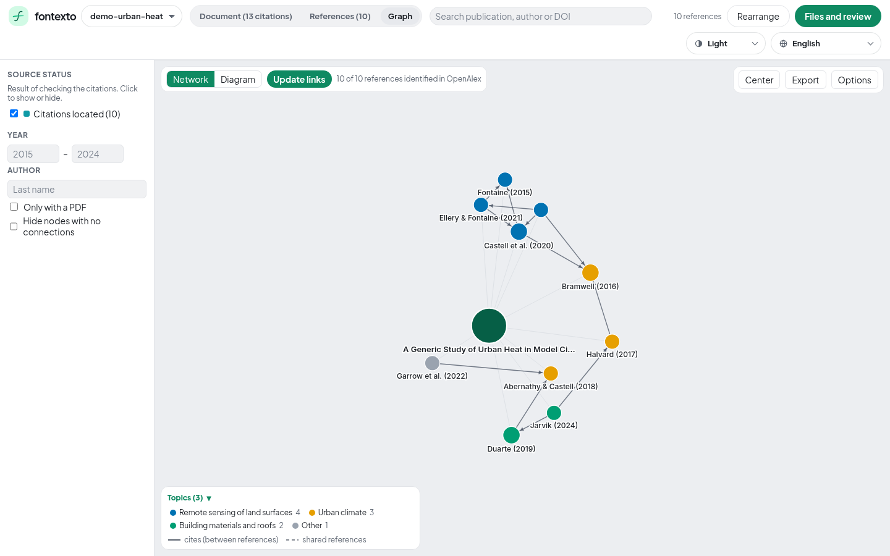
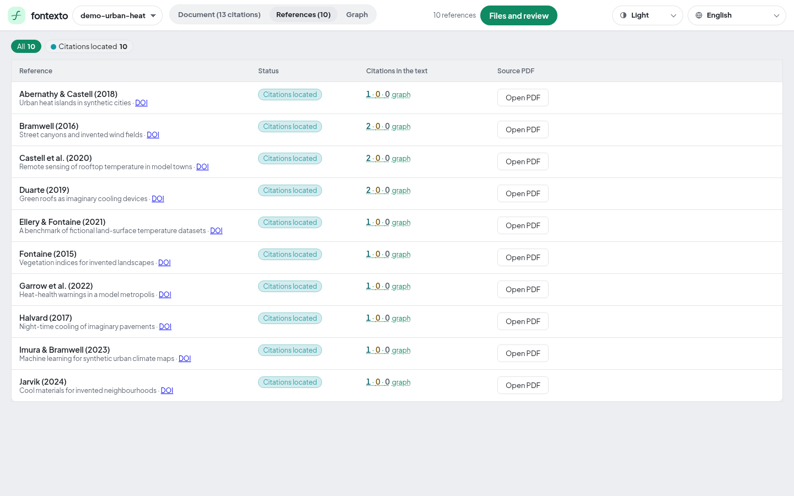

# Fontexto

[English](README.md) · [Español](README.es.md) · **Русский** · [Português (Brasil)](README.pt-BR.md)

Fontexto связывает каждую ссылку в научном тексте (диссертации, дипломной работе, статье) с точным фрагментом цитируемого источника. Загрузите PDF: Fontexto прочитает список литературы, найдёт легальные бесплатные версии цитируемых статей и для каждой ссылки покажет страницу, где источник говорит об этом, — чтобы вы могли проверить сами. Попробуйте на **[fontexto.com](https://fontexto.com)**.



## Что умеет

- **Ссылки → фрагменты.** Каждая ссылка в тексте (автор–год или номер) сопоставляется с записью списка литературы и с фрагментами-кандидатами в PDF источника с метками *Найдено*, *С оговоркой* или *Не найдено*. Метки — кандидаты для проверки человеком, а не доказательство.
- **Список литературы без `.bib`.** ABNT, APA, Harvard, IEEE, Vancouver, ГОСТ, DIN, французский «автор–год» и GB/T 7714, в том числе источники на кириллице и китайском, диссертации, нестандартные DOI и списки без заголовка «Список литературы».
- **Бесплатные PDF — легально.** Копии в открытом доступе ищутся в OpenAlex, Crossref, Unpaywall, Europe PMC, arXiv, Semantic Scholar и CORE. Из браузера уходят только DOI, название, год и первый автор источника.
- **Сеть источников (граф v2).** Одним нажатием «Найти связи между источниками» OpenAlex показывает, какие из ваших источников цитируют друг друга (стрелки) и у каких есть общие ссылки (пунктир). Узлы окрашены по темам; кликабельная легенда переключает тему, подобласть и область для широких списков. Масштаб, перемещение и жесты, соседи при наведении, размер узлов по ссылкам в тексте или глобальному цитированию, шкала времени по годам, фильтры по году, типу и теме, экспорт в PNG или SVG 1600×900. Без поиска источники группируются по ключевым словам названий.
- **Четыре языка.** Интерфейс на английском (по умолчанию), испанском, русском и бразильском португальском.
- **Приватность.** В веб-версии ваши PDF не покидают браузер (IndexedDB). Нет сторонней аналитики и сторонних скриптов. На главной может появиться анонимный итог посещений за 30 дней, когда он превысит 1000.





*На снимках — вымышленный документ и вымышленные источники. Интерфейс показан на английском.*

## Требования

- Node.js ≥ 20.10 (проверено на Node 24)

## Локальный запуск

```bash
npm install
npm run demo:seed        # необязательно: полностью синтетический демо-проект в ./data
npm run dev              # API на 127.0.0.1:5174 + интерфейс на http://127.0.0.1:5173
```

Продакшн-сборка:

```bash
npm run build            # проверка типов + веб-бандл + сервер
npm start                # API и интерфейс на http://127.0.0.1:5174
```

Подключение локальных файлов без загрузки и копирования:

```bash
npm run ingest -- --project moya-rabota --name "Моя работа" \
  --bib путь/refs.bib --main путь/rabota.pdf --refs "путь/папка-со-статьями"
```

Файлы регистрируются **по пути**: они не копируются и не изменяются. Переменные окружения (порт, папка данных, необязательные ключи `OPENALEX_API_KEY`, `CORE_API_KEY` и `S2_API_KEY` для прокси открытого доступа) описаны в [английском README](README.md#environment).

## Тесты

```bash
npm test
```

Все тестовые данные синтетические: вымышленные работы с DOI фиктивного префикса `10.99999` и PDF, создаваемые во время прогона.

## Правила научной добросовестности

- Библиографические данные, страницы и координаты не выдумываются. Неизвестное показывается как недоступное.
- Слабые совпадения остаются *непроверенными*, пока их не подтвердит человек.
- Тематические связи только *предлагаются* и никогда не означают цитирование.
- Автоматические методы никогда не помечают подтверждение как *проверенное*.

Как вычисляются метки и их ограничения: [`docs/matcher-evaluation.md`](docs/matcher-evaluation.md) (на английском).

## Веб-версия и программа для Windows

`npm run build:site` собирает статический сайт (`dist/site`) без сервера приложений: разбор PDF, извлечение списка литературы и поиск фрагментов выполняются в Web Workers, проекты хранятся в IndexedDB браузера. Единственный серверный код — небольшой прокси открытого доступа в `functions/api/oa/` и анонимный счётчик посещений в `functions/api/visits.ts`. `npm run package:win` собирает офлайн-версию для Windows. Подробности — в [английском README](README.md).

## Безопасность

Сообщайте об уязвимостях конфиденциально, как описано в [SECURITY.md](SECURITY.md).

## Лицензия

Fontexto — свободное ПО под лицензией [GNU Affero General Public License v3.0 или новее](LICENSE) (AGPL-3.0-or-later). Если вы запускаете изменённую версию как сетевой сервис, вы должны предоставить её исходный код пользователям.
